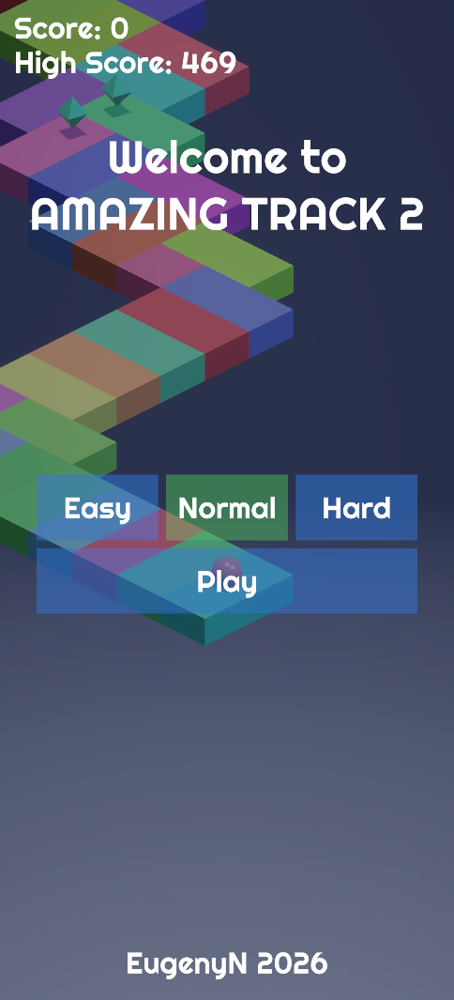

# Amazing Track 2

**Amazing Track 2** is a ZigZag-like endless arcade game. Tap to switch the
ball's movement direction and try to stay on the track as long as you can.
Collect crystals in a row to reach the max combo.

The goal of the project is to explore spec-driven development with
[OpenSpec](https://github.com/Fission-AI/openspec): every feature starts as a
specification, and the game is built from those specs.

Developed with Unity 6 and [LeoEcsLite](https://github.com/Leopotam/ecslite).

  

## Gameplay

- Tap to switch direction - stay on the track as long as you can
- Three modes: **Easy**, **Normal** and **Hard**
- Jump over holes - every gap is jumpable
- Grab **crystals** and chain **combos** for bonus points
- Score points to reach the next level - every level the ball moves faster
- Fall off the track and it's game over - beat your high score

## Play

Play in browser or download: **[eugenyn.itch.io/amazing-track2](https://eugenyn.itch.io/amazing-track2)**

Use touch, mouse, keyboard, or gamepad for controls.

## Getting started

Open the project in Unity 6, open `Assets/Scenes/GameScene.unity` and press **Play**.

## Development

Game behavior is specified with OpenSpec: requirements live in `openspec/specs/`,
feature work is planned as changes in `openspec/changes/`. See `AGENTS.md`
for agent contribution guidelines.

## License & Credits

- Code - Eugeny Novikov, [MIT](LICENSE.md)
- ECS - [LeoEcsLite](https://github.com/Leopotam/ecslite), MIT
- SFX - Dustyroom Casual Game Sound, CC0
- Font - [Righteous](https://fonts.google.com/specimen/Righteous) by Astigmatic, [OFL 1.1](Assets/Font/OFL.txt)
